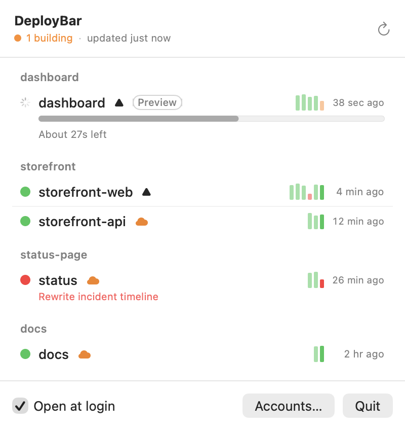
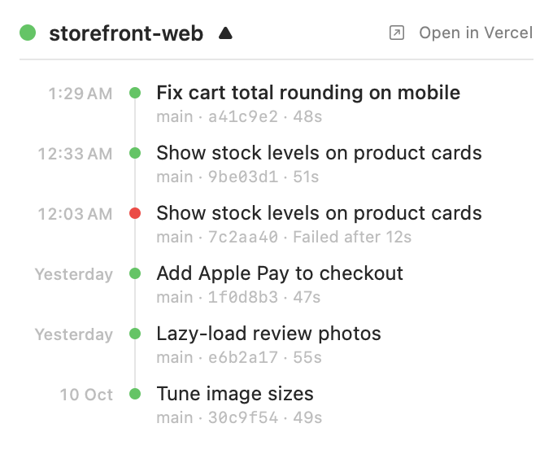
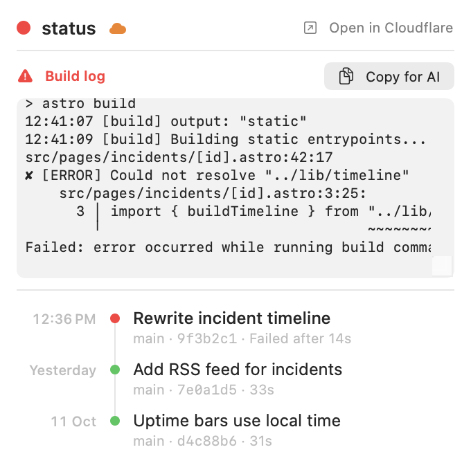
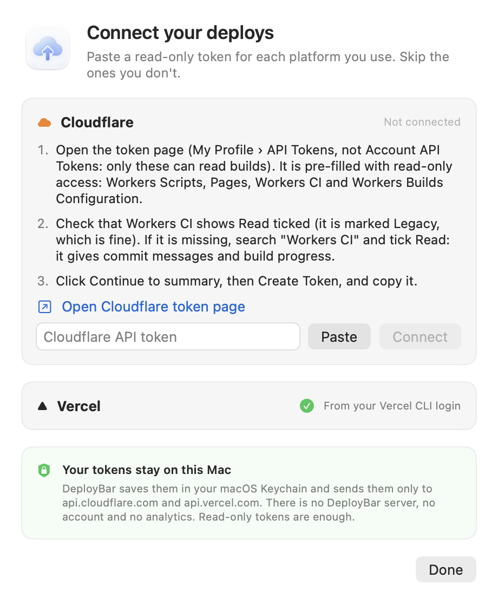

<p align="center"></p>
<h1 align="center">DeployBar</h1>
<p align="center"><b>Stop refreshing your deploy dashboard.</b><br>Every Cloudflare, Vercel and Azure DevOps deploy, in your Mac's menu bar.</p>

<p align="center">
  <picture>
    <source media="(prefers-color-scheme: dark)" srcset="assets/screenshot-dark.png">
    
  </picture>
  <picture>
    <source media="(prefers-color-scheme: dark)" srcset="assets/timeline-dark.png">
    
  </picture>
</p>

You ship ten times a day. Your AI agent pushes, a build starts somewhere, and you sit in a browser tab hitting refresh to see if it went live. DeployBar does the watching for you: a quiet icon in the menu bar, and a notification the second a deploy is live or broken.

## Why you'll keep it open

- **Know the second it starts.** A small popover slides out of the menu bar icon when a build starts, with a live progress bar. It stays until the build finishes or you close it, and never takes focus from what you're typing.
- **Know the second it's live.** A notification for every deploy that finishes, with the project, branch and commit message. Failed builds get a red mark so they stand out. Click it to jump to the deploy.
- **Know the second it breaks.** Failed apps turn red and show the commit that broke them, so you know exactly what to fix (or what to paste back into your AI).
- **Hand the error to your AI.** Click a failed app to see the tail of its build log, then Copy for AI to put the error, commit and log on your clipboard as a ready-made prompt for Claude Code, Cursor or Codex.
- **See how long you'll wait.** A live progress bar against that app's usual build time: "About 27s left".
- **Spot slow builds.** Each app shows a bar for each recent build. Taller means slower, red means failed.
- **Click for the story.** Click an app to see its recent deploys as a timeline: when, which commit, how long. Click any of them, or Open in Vercel / Cloudflare / Azure DevOps, to jump to the dashboard.
- **All your projects, one glance.** Cloudflare Workers, Pages, Vercel and Azure DevOps Pipelines side by side, grouped by repo.
- **Free, open source, private.** Runs on your Mac and talks only to the Cloudflare, Vercel and Azure DevOps APIs. Your tokens stay in your Keychain.

<p align="center">
  <picture>
    <source media="(prefers-color-scheme: dark)" srcset="assets/failure-dark.png">
    
  </picture>
</p>

Requires macOS 14 or later and the Swift toolchain (install it with `xcode-select --install`).

## Get it running in 2 minutes

**1. Build and open it.**

```bash
git clone https://github.com/maestro3517/deploybar.git && cd deploybar && ./build.sh --install
```

This builds the app, copies it to `~/Applications` and opens it.

**2. Connect your accounts.** On first launch DeployBar opens a setup window. For each platform it links to the token page (the Cloudflare link pre-fills a read-only token), you paste the token and it checks it before saving. Already logged in with `vercel login`? Vercel connects by itself. For Azure DevOps, create a personal access token with only **Build › Read**, then enter your organization (`acme` or `https://dev.azure.com/acme`) and project. Reopen the window any time from **Accounts…** in the menu.

<picture>
  <source media="(prefers-color-scheme: dark)" srcset="assets/setup-dark.png">
  
</picture>

**Your tokens stay on your Mac.** DeployBar saves them in your macOS Keychain and sends them only to api.cloudflare.com, api.vercel.com and dev.azure.com. There is no DeployBar server, no account and no analytics. Read-only tokens are enough.

**Prefer the terminal?** Set `CLOUDFLARE_API_TOKEN`, `VERCEL_TOKEN` or `AZURE_DEVOPS_EXT_PAT` (with `AZURE_DEVOPS_ORG` and `AZURE_DEVOPS_PROJECT`) in your environment, or save the token to your Keychain yourself. Got several Cloudflare accounts? Save the account id too (otherwise the first account is used):

```bash
security add-generic-password -s deploybar -a cloudflare-token -w <API token>
security add-generic-password -s deploybar -a vercel-token -w <API token>
security add-generic-password -s deploybar -a cloudflare-account -w <account id>
security add-generic-password -s deploybar -a azure-token -w <personal access token>
security add-generic-password -s deploybar -a azure-org -w <organization>
security add-generic-password -s deploybar -a azure-project -w <project>
```

**3. Allow notifications** when macOS asks. Missed it? The menu shows a Turn On… button.

Tick **Open at login** in the menu and forget about it.

## Tips

**Group apps into one project.** If your frontend and API deploy separately, put them under one heading. Create `~/Library/Application Support/DeployBar/projects.json`:

```json
[
  {"name": "Shop", "match": ["shop-web", "shop-api"]},
  {"name": "Docs", "match": ["docs"]}
]
```

An app joins the first project whose `match` text appears in its repo or app name. Restart DeployBar after editing.

**Test notifications:**

```bash
~/Applications/DeployBar.app/Contents/MacOS/DeployBar --notify-test
```

DeployBar only notifies when a deploy goes from building to done or failed while it's running. It never replays old deploys.

## Development

- `swift build && .build/debug/DeployBar --selftest` runs the checks.
- `--dump` prints every fetched deploy and error.
- `--snapshot <dir> [--demo]` renders the menu to `light.png` and `dark.png`; `--demo` uses made-up data (that is how the screenshot above was made).
- `scripts/make-icon.sh` regenerates the app icon. `scripts/make-promo.sh` renders the promo video and images into `marketing/`.
- **Add a platform.** Each platform is one `case` in `Provider` (`Sources/DeployBar/Providers.swift`): its name, token setup steps, a token check and a fetch that returns `[Deploy]`. The compiler points you at every `switch` to fill in. Netlify, Render and Fly.io PRs welcome.

Pull requests welcome. Ideas: a prebuilt download.

## License

MIT
